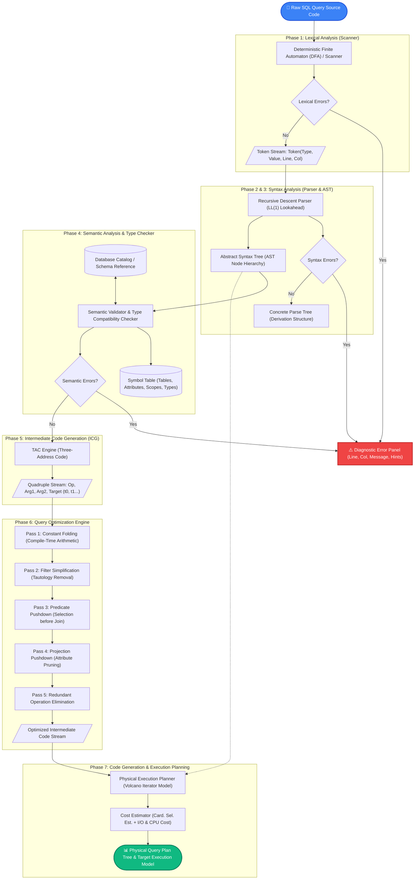
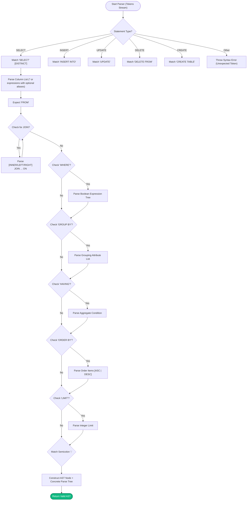
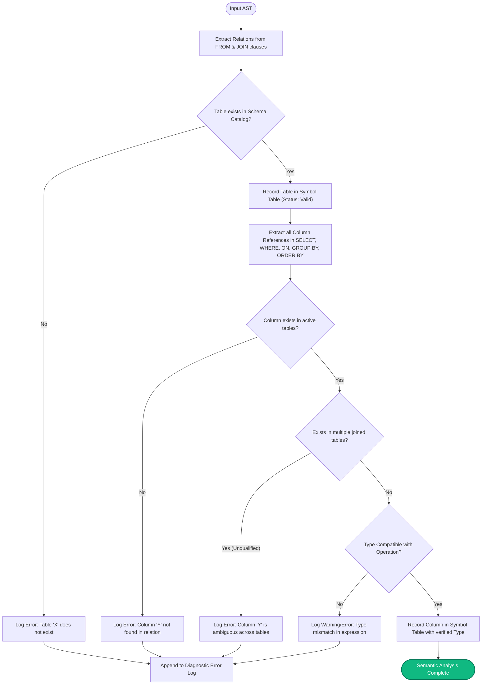
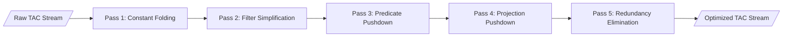
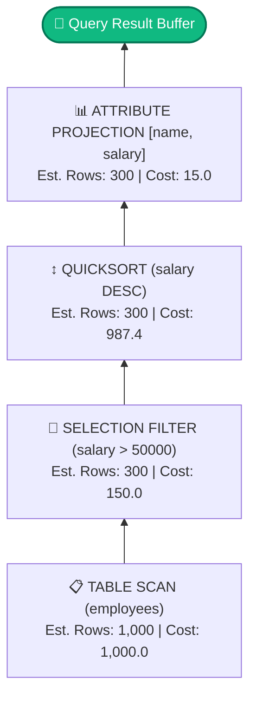
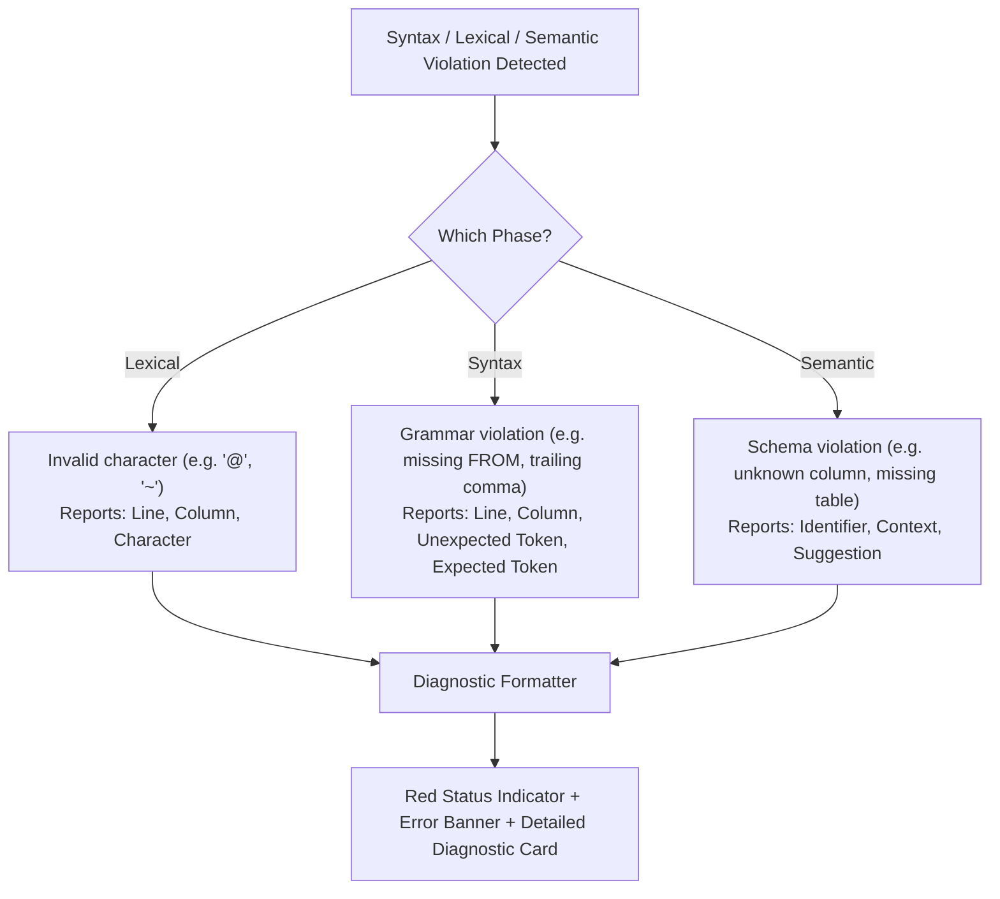

# SQL Query Compiler & Phase Visualizer
## Comprehensive Project Report, Architecture Brief & Flowchart Guide

**Domain:** Compiler Design / Compiler Construction (Computer Science & Engineering)  
**Project Name:** SQL Query Compiler & Phase Visualizer  
**Technology Stack:** HTML5, Modern CSS3, Pure Client-Side JavaScript (ES6+), Node.js (Static Server)  
**Execution Environment:** Zero External Dependencies (100% Offline Capable)

---

## 📑 Table of Contents
1. [Executive Project Brief](#1-executive-project-brief)
   - 1.1 Project Title & Overview
   - 1.2 Problem Statement & Motivation
   - 1.3 Key Objectives & Scope
2. [End-to-End System Architecture](#2-end-to-end-system-architecture)
   - 2.1 Complete Compiler Pipeline (Mermaid Diagram)
   - 2.2 Textual / ASCII High-Level Flowchart
3. [Phase-by-Phase Technical Specifications & Flowcharts](#3-phase-by-phase-technical-specifications--flowcharts)
   - 3.1 Phase 1 — Lexical Analysis (Scanner / Tokenizer)
   - 3.2 Phase 2 — Syntax Analysis (Recursive Descent Parser)
   - 3.3 Phase 3 — Abstract Syntax Tree (AST Generation)
   - 3.4 Phase 4 — Semantic Analysis & Symbol Table Verification
   - 3.5 Phase 5 — Intermediate Code Generation (Three-Address Code / Quadruples)
   - 3.6 Phase 6 — Code Optimization Engine (5-Pass Algebraic Optimizer)
   - 3.7 Phase 7 — Execution Planner & Code Generation (Physical Plan Tree & Cost Model)
4. [Grammar Specification (EBNF)](#4-grammar-specification-ebnf)
5. [Relational Database Catalog / Active Schema](#5-relational-database-catalog--active-schema)
6. [Complete Step-by-Step Query Compilation Walkthrough](#6-complete-step-by-step-query-compilation-walkthrough)
7. [Error Handling & Diagnostic System](#7-error-handling--diagnostic-system)
8. [File Structure & Technical Implementation](#8-file-structure--technical-implementation)
9. [Viva / Presentation Cheatsheet](#9-viva--presentation-cheatsheet)

---

## 1. Executive Project Brief

### 1.1 Project Title & Overview
The **SQL Query Compiler & Phase Visualizer** is an educational, production-grade compiler pipeline and interactive visualization suite built specifically for **Compiler Design / Language Processor** laboratory and theoretical curricula.

Unlike standard general-purpose language compilers (such as C or Java compilers) which target machine instructions or bytecodes, a Database SQL Compiler targets **Relational Algebra operators and Physical Execution Plans**. This project implements and visually renders every foundational phase of classical compiler theory using Structured Query Language (SQL) as the source domain.

### 1.2 Problem Statement & Motivation
In undergraduate and graduate Computer Science curricula, compiler design concepts (lexing, recursive descent parsing, symbol tables, Three-Address Code generation, and intermediate optimizations) are frequently taught using abstract theoretical pseudocode. Students rarely get to observe the state transitions between phases in real time.

Furthermore, SQL engines (PostgreSQL, SQLite, MySQL) conceal their internal compiler stages inside complex C/C++ engines. This project solves that gap by delivering:
- A completely transparent, 7-stage compiler pipeline implemented in modern JavaScript.
- Interactive token inspections with exact line/column tracking.
- Interactive dual syntax visualization: Concrete Parse Tree and Abstract Syntax Tree (AST).
- Static schema checking against relational catalog definitions.
- Quadruple-based Three-Address Code (TAC) generation with temporaries ($t_1, t_2, \dots$).
- Multi-pass query rewriting (Constant Folding, Predicate Pushdown, Column Pruning).
- Physical Volcano-style iterator execution plans with estimated I/O and CPU cost calculations.

### 1.3 Key Objectives & Scope
- **Fidelity to Classic Compiler Stages:** Strictly maps to the standard Dragon Book (*Compilers: Principles, Techniques, and Tools*) compiler pipeline.
- **Client-Side Portability:** Operates with 0 npm package dependencies and 0 build steps. Works directly in any browser or through a zero-config Node.js static server.
- **Robust Error Diagnostics:** Provides immediate visual diagnostics for lexical errors, syntax violations with expected token hints, and semantic anomalies (unknown relations, missing attributes, ambiguous column projections).
- **Extensible Relational Grammar:** Supports `SELECT` (with `DISTINCT`, `JOIN`, `WHERE`, `GROUP BY`, `HAVING`, `ORDER BY`, `LIMIT`), `INSERT`, `UPDATE`, `DELETE`, and `CREATE TABLE`.

---

## 2. End-to-End System Architecture

### 2.1 Complete Compiler Pipeline (Mermaid Diagram)



---

### 2.2 Textual / ASCII High-Level Flowchart

```text
┌──────────────────────────────────────────────────────────────┐
│                  SQL Source Query Text                       │
└──────────────────────────────┬───────────────────────────────┘
                               │
                               ▼
┌──────────────────────────────────────────────────────────────┐
│  PHASE 1: LEXICAL ANALYSIS (Lexer / Tokenizer)               │
│  - Strips whitespace & comments (-- and /* */)               │
│  - DFA tokenizes keywords, identifiers, numbers, operators   │
│  - Output: List<Token(Type, Value, Line, Col, Pos)>          │
└──────────────────────────────┬───────────────────────────────┘
                               │
                               ▼
┌──────────────────────────────────────────────────────────────┐
│  PHASE 2 & 3: SYNTAX ANALYSIS (Recursive Descent Parser)     │
│  - Enforces SQL Grammar (SELECT, WHERE, JOIN, ORDER BY...)   │
│  - Lookahead matching with syntax error diagnostics          │
│  - Output: Concrete Parse Tree + Abstract Syntax Tree (AST)  │
└──────────────────────────────┬───────────────────────────────┘
                               │
                               ▼
┌──────────────────────────────────────────────────────────────┐
│  PHASE 4: SEMANTIC ANALYSIS & SYMBOL TABLE                   │
│  - Verifies relation existence against database schema       │
│  - Resolves column names, detects cross-join ambiguities     │
│  - Type checks comparison expressions & aggregates           │
│  - Output: Populated Symbol Table + Annotated AST            │
└──────────────────────────────┬───────────────────────────────┘
                               │
                               ▼
┌──────────────────────────────────────────────────────────────┐
│  PHASE 5: INTERMEDIATE CODE GENERATION (TAC Engine)          │
│  - Converts hierarchical AST into linear Three-Address Code  │
│  - Quadruple Format: (Op, Arg1, Arg2, Target Temp)           │
│  - Output: Linear TAC Stream (t1 = LOAD, t2 = FILTER...)     │
└──────────────────────────────┬───────────────────────────────┘
                               │
                               ▼
┌──────────────────────────────────────────────────────────────┐
│  PHASE 6: CODE OPTIMIZATION (Multi-Pass Query Optimizer)     │
│  - Pass 1: Constant Folding (e.g., 2 + 3 * 4 -> 14)          │
│  - Pass 2: Filter Simplification (1=1, TRUE elimination)     │
│  - Pass 3: Predicate Pushdown (Filter before Join)           │
│  - Pass 4: Projection Pushdown (Prune unused columns)        │
│  - Pass 5: Redundancy Elimination (DISTINCT + GROUP BY)      │
│  - Output: Optimized TAC Instruction Stream                  │
└──────────────────────────────┬───────────────────────────────┘
                               │
                               ▼
┌──────────────────────────────────────────────────────────────┐
│  PHASE 7: CODE GENERATION / PHYSICAL EXECUTION PLAN          │
│  - Maps algebraic TAC instructions into physical operators   │
│  - Operators: SeqScan, HashJoin, Filter, Sort, Aggregate     │
│  - Calculates Cost Estimation (Card * Sel * Weight)          │
│  - Output: Executable Relational Pipeline Tree               │
└──────────────────────────────────────────────────────────────┘
```

---

## 3. Phase-by-Phase Technical Specifications & Flowcharts

### 3.1 Phase 1 — Lexical Analysis (Scanner / Tokenizer)

#### Description & Theoretical Foundation
The Lexer converts an unstructured stream of Unicode characters into a structured sequence of atomic tokens. It tracks coordinate information (`line`, `column`, `position`) for precision error mapping.

#### Supported Token Categories
| Token Type | Examples | Description |
| :--- | :--- | :--- |
| `KEYWORD` | `SELECT`, `FROM`, `WHERE`, `JOIN`, `GROUP`, `BY`, `ORDER` | Reserved language commands |
| `IDENTIFIER` | `employees`, `salary`, `dept_id`, `name` | Table names, column references, aliases |
| `NUMBER` | `50000`, `3.14`, `100` | Integer and floating-point literals |
| `STRING` | `'Engineering'`, `'Active'` | Single-quoted string constants |
| `OPERATOR` | `=`, `<>`, `!=`, `<`, `<=`, `>`, `>=`, `+`, `-`, `*`, `/`, `%` | Comparison and arithmetic operators |
| `COMMA` | `,` | Attribute and expression separator |
| `SEMICOLON` | `;` | End-of-statement delimiter |
| `PUNCTUATION` | `(`, `)`, `.` | Expression grouping, qualified names (`table.col`) |
| `COMMENT` | `-- line`, `/* block */` | Developer annotations (ignored by parser) |
| `ERROR` | `@`, `~`, `$` | Unrecognized lexical characters |

#### Lexer State Flowchart (Mermaid)

```mermaid
stateDiagram-v2
    [*] --> Start
    Start --> Whitespace: isWhitespace(ch)
    Whitespace --> Start: advance()

    Start --> LineComment: ch == '-' and next == '-'
    LineComment --> LineComment: ch != '\n'
    LineComment --> Start: ch == '\n'

    Start --> BlockComment: ch == '/' and next == '*'
    BlockComment --> BlockComment: not '*/'
    BlockComment --> Start: '*/'

    Start --> NumberToken: isDigit(ch)
    NumberToken --> NumberToken: isDigit(ch) or '.'
    NumberToken --> [*]: emit(NUMBER)

    Start --> StringToken: ch == '\''
    StringToken --> StringToken: ch != '\'' (handle '')
    StringToken --> [*]: emit(STRING)

    Start --> WordToken: isAlpha(ch) or '_'
    WordToken --> WordToken: isAlphaNumeric(ch) or '_'
    WordToken --> KeywordCheck: lookup in KEYWORDS
    KeywordCheck --> [*]: emit(KEYWORD or IDENTIFIER)

    Start --> OperatorToken: '<>=!+-*/%'
    OperatorToken --> OperatorToken: lookahead 2-char op (<=, >=, <>, !=, ==)
    OperatorToken --> [*]: emit(OPERATOR)

    Start --> PunctuationToken: '(),;.'
    PunctuationToken --> [*]: emit(COMMA / SEMI / PUNCT)

    Start --> ErrorToken: default
    ErrorToken --> [*]: emit(ERROR) & register error
```



---

### 3.2 Phase 2 — Syntax Analysis (Recursive Descent Parser)

#### Description & Theoretical Foundation
The Parser performs deterministic top-down parsing with 1-token lookahead (LL(1) style). It enforces SQL syntax, verifies grammar rules, constructs a derivation tree (Concrete Parse Tree), and flags unexpected tokens with explanatory hints.

#### Key Parser Grammar Methods in `compiler.js`
- `_statement()`: Dispatches to `_select()`, `_insert()`, `_update()`, `_delete()`, or `_createTable()`.
- `_select()`: Enforces the canonical SQL structure:  
  `SELECT [DISTINCT] <columns> FROM <table> [JOINs] [WHERE] [GROUP BY] [HAVING] [ORDER BY] [LIMIT];`
- `_expr()`: Handles operator precedence across `OR` $\rightarrow$ `AND` $\rightarrow$ `NOT` $\rightarrow$ Comparisons ($=, <, >, \dots$) $\rightarrow$ Additive ($+, -$) $\rightarrow$ Multiplicative ($*, /, \%$) $\rightarrow$ Unary $\rightarrow$ Primary.

#### Parsing Flowchart (Mermaid)



---

### 3.3 Phase 3 — Abstract Syntax Tree (AST Generation)

#### AST Node Taxonomy & Structural Hierarchy
The Abstract Syntax Tree discards concrete punctuation (parentheses, commas, keyword markers) and retains only the essential semantic structure:

```text
SelectStatement
├── distinct: false
├── columns (Array<SelectItem>)
│   ├── SelectItem { expr: ColumnRef("name"), alias: null }
│   └── SelectItem { expr: ColumnRef("salary"), alias: null }
├── from: TableRef { name: "employees", alias: null }
├── joins: []
├── where: BinaryExpr
│   ├── op: ">"
│   ├── left: ColumnRef("salary")
│   └── right: Literal(50000, "NUMBER")
├── groupBy: null
├── having: null
├── orderBy (Array<OrderByItem>)
│   └── OrderByItem { expr: ColumnRef("salary"), direction: "DESC" }
└── limit: null
```

---

### 3.4 Phase 4 — Semantic Analysis & Symbol Table Verification

#### Description & Responsibilities
The Semantic Analyzer operates on the generated AST. It performs context-sensitive checks that cannot be validated at the grammar level:
1. **Catalog Existence:** Ensures requested tables exist in the schema dictionary.
2. **Attribute Verification:** Confirms all referenced columns belong to the active tables.
3. **Ambiguity Resolution:** Detects columns present in multiple relations across multi-table JOINs without an explicit table qualifier.
4. **Type Compatibility Checking:** Validates that arithmetic operators are applied to numerical fields, string functions receive string arguments, and comparison operands are mutually comparable.
5. **Symbol Table Generation:** Populates an explicit symbol table with identifier names, data types, origin clauses (`FROM`, `WHERE`, `SELECT`), and validation statuses.

#### Semantic Validation Flowchart (Mermaid)



---

### 3.5 Phase 5 — Intermediate Code Generation (Three-Address Code / Quadruples)

#### Description & Theoretical Foundation
The ICG phase linearizes the hierarchical AST into **Three-Address Code (TAC)**. Each TAC instruction has at most one operator and at most three addresses (two operands and one destination temporary variable $t_n$).

#### Quadruple Format
$$\text{Quadruple} = (\text{Operator},\; \text{Argument}_1,\; \text{Argument}_2,\; \text{Result})$$

#### TAC Operator Catalog in this Project
- `LOAD`: Loads a relation or column attribute into a working buffer.
- `CONST`: Loads a literal constant (numeric or string) into a temporary.
- `FILTER`: Applies a conditional predicate against an active relation buffer.
- `INNER_JOIN` / `LEFT_JOIN`: Performs relational join on a condition temporary.
- `GROUP_BY`: Partitions tuples by specified attribute list.
- `SORT`: Orders tuples by sorting keys and direction.
- `PROJECT`: Projects out only the requested output attributes.
- `LIMIT`: Truncates result set to $N$ rows.
- `RETURN`: Returns final result set temporary to caller.

#### TAC Generation Flowchart (Mermaid)

```mermaid
flowchart TD
    ASTNode(["AST SelectStatement"]) --> LoadBase["Emit: t1 = LOAD &lt;from_table&gt;"]
    LoadBase --> HasJoins{"Has JOIN clauses?"}

    HasJoins -- Yes --> GenJoin["Emit: t2 = LOAD &lt;join_table&gt;<br/>Lower condition to t3<br/>Emit: t4 = INNER_JOIN t1, t2, t3"]
    HasJoins -- No --> HasWhere{"Has WHERE predicate?"}
    GenJoin --> HasWhere

    HasWhere -- Yes --> LowerCond["Recursively lower expression tree into TAC temporaries (t_cond)<br/>Emit: t_filt = FILTER t_prev, t_cond"]
    HasWhere -- No --> HasGroupBy{"Has GROUP BY?"}
    LowerCond --> HasGroupBy

    HasGroupBy -- Yes --> GenGroup["Emit: t_grp = GROUP_BY t_prev, [attributes]"]
    HasGroupBy -- No --> HasHaving{"Has HAVING?"}
    GenGroup --> HasHaving

    HasHaving -- Yes --> GenHaving["Lower condition to t_hav<br/>Emit: t_hav_res = FILTER t_prev, t_hav"]
    HasHaving -- No --> HasOrderBy{"Has ORDER BY?"}
    GenHaving --> HasOrderBy

    HasOrderBy -- Yes --> GenSort["Emit: t_sort = SORT t_prev, [columns ASC/DESC]"]
    HasOrderBy -- No --> GenProject["Emit: t_proj = PROJECT t_prev, [selected columns]"]
    GenSort --> GenProject

    GenProject --> HasLimit{"Has LIMIT?"}
    HasLimit -- Yes --> GenLimit["Emit: t_lim = LIMIT t_proj, &lt;N&gt;"]
    HasLimit -- No --> GenReturn["Emit: RETURN t_final"]
    GenLimit --> GenReturn

    GenReturn --> TACDone(["TAC Stream Completed"]):::outputClass

    classDef outputClass fill:#10b981,stroke:#047857,stroke-width:2px,color:#fff;
```



---

### 3.6 Phase 6 — Code Optimization Engine (5-Pass Algebraic Optimizer)

#### Description & Optimization Techniques
The query optimizer takes the unoptimized TAC instructions and performs 5 classical compiler optimization passes:



1. **Pass 1: Constant Folding (Algebraic Simplification):**
   - Detects operations between compile-time constants (e.g., `CONST 2`, `CONST 3`, `CONST 4`, `MUL`, `ADD`).
   - Evaluates arithmetic at compile-time: $2 + (3 \times 4) \rightarrow 14$.
   - Replaces the multi-instruction sequence with a single constant assignment.
2. **Pass 2: Filter Simplification (Tautology Removal):**
   - Identifies unconditional boolean conditions (e.g., `WHERE 1 = 1`, `WHERE TRUE`).
   - Removes unnecessary evaluation overhead from the runtime pipeline.
3. **Pass 3: Predicate Pushdown (Relational Rewrite):**
   - Reorders relational algebra operators so that selection filters are applied *before* expensive joins.
   - Drastically reduces intermediate relation cardinality.
4. **Pass 4: Projection Pushdown (Attribute Pruning):**
   - Identifies which columns are strictly necessary for subsequent operations.
   - Eliminates unused column reads early during table scans.
5. **Pass 5: Redundant Operation Elimination:**
   - Detects redundant operations such as `DISTINCT` combined with `GROUP BY` (since grouping already guarantees unique grouping keys).

---

### 3.7 Phase 7 — Execution Planner & Code Generation (Physical Plan Tree & Cost Model)

#### Description & Volcano Iterator Model
The Execution Planner translates optimized intermediate code into a tree of executable physical operators. In a real database management system (DBMS), each node implements the **Volcano Iterator Model** interface:
- `open()`: Initializes buffers and sub-operators.
- `next()`: Yields the next tuple on demand (pipelined execution).
- `close()`: Frees resources.

#### Cost Model Estimation Formula
For each physical operator node $i$:
$$\text{Estimated Cost}(i) = \text{Cardinality}_{\text{input}} \times \text{Selectivity} \times \text{Weight}_{\text{op}}$$
$$\text{Total Plan Cost} = \sum_{i=1}^{M} \text{Estimated Cost}(i)$$

- **Table Scan:** Sequential row read ($\text{Cost} = \text{Rows} \times 1.0$)
- **Filter (Selection):** Evaluates predicate ($\text{Cost} = \text{Rows} \times 0.15$, typical selectivity = $0.3$)
- **Join (Hash Join):** Builds hash table & probes ($\text{Cost} = \text{Rows} \times 1.5$)
- **Aggregate (Hash Aggregate):** Groups and aggregates ($\text{Cost} = \text{Rows} \times 1.8$)
- **Sort (Quicksort):** CPU sorting ($\text{Cost} = N \log_2(N) \times 0.4$)
- **Projection:** Tuple slicing ($\text{Cost} = \text{Rows} \times 0.05$)

#### Execution Plan Tree Diagram (Mermaid)



---

## 4. Grammar Specification (EBNF)

The formal context-free grammar implemented by this compiler in Extended Backus-Naur Form (EBNF):

```ebnf
Statement        ::= SelectStmt | InsertStmt | UpdateStmt | DeleteStmt | CreateStmt ';' ;

SelectStmt       ::= 'SELECT' [ 'DISTINCT' ] SelectList
                     'FROM' TableRef
                     { JoinClause }
                     [ 'WHERE' Expression ]
                     [ 'GROUP' 'BY' ExprList ]
                     [ 'HAVING' Expression ]
                     [ 'ORDER' 'BY' OrderList ]
                     [ 'LIMIT' NUMBER ] ;

SelectList       ::= '*' | SelectItem { ',' SelectItem } ;
SelectItem       ::= Expression [ [ 'AS' ] IDENTIFIER ] ;

TableRef         ::= IDENTIFIER [ [ 'AS' ] IDENTIFIER ] ;
JoinClause       ::= [ 'INNER' | 'LEFT' | 'RIGHT' | 'CROSS' ] 'JOIN' TableRef 'ON' Expression ;

OrderList        ::= OrderItem { ',' OrderItem } ;
OrderItem        ::= Expression [ 'ASC' | 'DESC' ] ;

Expression       ::= OrExpr ;
OrExpr           ::= AndExpr { 'OR' AndExpr } ;
AndExpr          ::= NotExpr { 'AND' NotExpr } ;
NotExpr          ::= [ 'NOT' ] ComparisonExpr ;
ComparisonExpr   ::= AddExpr [ ( '=' | '!=' | '<>' | '<' | '<=' | '>' | '>=' | 'LIKE' | 'IS' [ 'NOT' ] 'NULL' ) AddExpr ] ;
AddExpr          ::= MultExpr { ( '+' | '-' ) MultExpr } ;
MultExpr         ::= PrimaryExpr { ( '*' | '/' | '%' ) PrimaryExpr } ;

PrimaryExpr      ::= Literal
                   | QualifiedColumn
                   | FunctionCall
                   | '(' Expression ')' ;

FunctionCall     ::= IDENTIFIER '(' [ 'DISTINCT' ] [ ExprList ] ')' ;
QualifiedColumn  ::= [ IDENTIFIER '.' ] IDENTIFIER ;
Literal          ::= NUMBER | STRING | 'TRUE' | 'FALSE' | 'NULL' ;
```

---

## 5. Relational Database Catalog / Active Schema

The compiler validates identifiers against an embedded relational catalog representing a corporate enterprise schema:

| Table | Column | Type | Primary Key | Nullable | Description |
| :--- | :--- | :--- | :---: | :---: | :--- |
| **`employees`** | `id` | `INTEGER` | 🔑 Yes | No | Employee identifier |
| | `name` | `VARCHAR` | No | No | Employee full name |
| | `department` | `VARCHAR` | No | Yes | Department name |
| | `department_id`| `INTEGER` | No | Yes | Foreign key to `departments.id` |
| | `salary` | `FLOAT` | No | No | Monthly compensation |
| | `age` | `INTEGER` | No | Yes | Employee age in years |
| | `is_active` | `BOOLEAN` | No | Yes | Active employment status |
| **`departments`**| `id` | `INTEGER` | 🔑 Yes | No | Department identifier |
| | `name` | `VARCHAR` | No | No | Department designation |
| | `budget` | `FLOAT` | No | Yes | Annual allocated budget |
| | `location` | `VARCHAR` | No | Yes | Physical office location |
| **`projects`** | `id` | `INTEGER` | 🔑 Yes | No | Project identifier |
| | `title` | `VARCHAR` | No | No | Project title |
| | `budget` | `FLOAT` | No | Yes | Project budget |
| | `dept_id` | `INTEGER` | No | Yes | Managing department ID |
| **`users`** | `id` | `INTEGER` | 🔑 Yes | No | User profile ID |
| | `name` | `VARCHAR` | No | No | User username |
| | `email` | `VARCHAR` | No | Yes | Contact email address |
| | `age` | `INTEGER` | No | Yes | User age |
| | `salary` | `FLOAT` | No | Yes | Stored income |
| **`orders`** | `id` | `INTEGER` | 🔑 Yes | No | Order number |
| | `user_id` | `INTEGER` | No | No | Foreign key to `users.id` |
| | `product_id` | `INTEGER` | No | No | Foreign key to `products.id` |
| | `quantity` | `INTEGER` | No | Yes | Units ordered |
| | `total_price` | `FLOAT` | No | Yes | Total invoiced amount |
| **`products`** | `id` | `INTEGER` | 🔑 Yes | No | SKU product identifier |
| | `name` | `VARCHAR` | No | No | Commercial name |
| | `price` | `FLOAT` | No | No | Unit retail price |
| | `stock` | `INTEGER` | No | Yes | Inventory in stock |

---

## 6. Complete Step-by-Step Query Compilation Walkthrough

### Example SQL Query
```sql
SELECT name, salary
FROM employees
WHERE salary > 50000
ORDER BY salary DESC;
```

### Trace Across All 7 Compiler Phases

#### Phase 1: Lexical Analysis (Tokens Output)
| Token # | Type | Value | Line | Col | Position |
| :---: | :--- | :--- | :---: | :---: | :---: |
| 1 | `KEYWORD` | `SELECT` | 1 | 1 | 0 |
| 2 | `IDENTIFIER` | `name` | 1 | 8 | 7 |
| 3 | `COMMA` | `,` | 1 | 12 | 11 |
| 4 | `IDENTIFIER` | `salary` | 1 | 14 | 13 |
| 5 | `KEYWORD` | `FROM` | 2 | 1 | 21 |
| 6 | `IDENTIFIER` | `employees` | 2 | 6 | 26 |
| 7 | `KEYWORD` | `WHERE` | 3 | 1 | 36 |
| 8 | `IDENTIFIER` | `salary` | 3 | 7 | 42 |
| 9 | `OPERATOR` | `>` | 3 | 14 | 49 |
| 10 | `NUMBER` | `50000` | 3 | 16 | 51 |
| 11 | `KEYWORD` | `ORDER` | 4 | 1 | 57 |
| 12 | `KEYWORD` | `BY` | 4 | 7 | 63 |
| 13 | `IDENTIFIER` | `salary` | 4 | 10 | 66 |
| 14 | `KEYWORD` | `DESC` | 4 | 17 | 73 |
| 15 | `SEMICOLON` | `;` | 4 | 21 | 77 |
| 16 | `EOF` | `""` | 4 | 22 | 78 |

#### Phase 2: Concrete Parse Tree (Derivation Structure)
```text
SELECT_STMT
├── COLUMNS
│   ├── name
│   └── salary
├── FROM
│   └── employees
├── WHERE
│   └── CONDITION
│       ├── salary
│       ├── >
│       └── 50000
└── ORDER_BY
    └── salary DESC
```

#### Phase 3: Abstract Syntax Tree (AST Inspector Data)
- **Node Type:** `SelectStatement`
- **Projection List:** `[ ColumnRef(name), ColumnRef(salary) ]`
- **From Relation:** `TableRef("employees")`
- **Filter Predicate:** `BinaryExpr(op: ">", left: ColumnRef("salary"), right: Literal(50000))`
- **Order Specification:** `[ OrderByItem(expr: ColumnRef("salary"), direction: "DESC") ]`

#### Phase 4: Semantic Analysis & Symbol Table
| Identifier | Category | Context | Data Type | Validation Status | Detailed Finding |
| :--- | :--- | :--- | :--- | :---: | :--- |
| `employees` | `TABLE` | `FROM` | Relation | **Valid** | Exists in schema (7 attributes) |
| `name` | `COLUMN` | `SELECT` | `VARCHAR` | **Valid** | Found in table `employees` |
| `salary` | `COLUMN` | `SELECT` | `FLOAT` | **Valid** | Found in table `employees` |
| `salary` | `COLUMN` | `WHERE` | `FLOAT` | **Valid** | Comparable with numeric literal |
| `salary` | `COLUMN` | `ORDER BY` | `FLOAT` | **Valid** | Valid sort key attribute |

#### Phase 5: Intermediate Code Generation (Three-Address Code)
```text
001  t1 = LOAD employees                 ; Load relation 'employees' into working buffer
002  t2 = LOAD salary                    ; Load attribute salary
003  t3 = CONST 50000                    ; Load constant 50000
004  t4 = GT t2, t3                      ; Evaluate binary operation GT(t2, t3)
005  t5 = FILTER t1, t4                  ; Filter rows satisfying condition (t4)
006  t6 = SORT t5, salary DESC           ; Sort tuples by salary DESC
007  t7 = PROJECT t6, name, salary       ; Project output attributes [name, salary]
008  RETURN t7                           ; Return final result set (t7)
```

#### Phase 6: Query Optimization Passes
- **Pass 1 (Constant Folding):** No static compile-time arithmetic.
- **Pass 2 (Filter Simplification):** Filter expression is non-tautological.
- **Pass 4 (Projection Pushdown):** Identifies that only attributes `name` and `salary` are referenced throughout the query pipeline. Pushes column restriction to the initial scan operator.
- **Resulting Optimized TAC:**
```text
001  t1 = LOAD employees (name, salary)  ; Scan only required attributes
002  t2 = LOAD salary
003  t3 = CONST 50000
004  t4 = GT t2, t3
005  t5 = FILTER t1, t4
006  t6 = SORT t5, salary DESC
007  t7 = PROJECT t6, name, salary
008  RETURN t7
```

#### Phase 7: Physical Execution Plan Tree & Cost Estimation
```text
┌────────────────────────────────────────────────────────┐
│ 4. ATTRIBUTE PROJECTION [name, salary]                 │
│    Access: Projection | Est. Rows: 300 | Cost: 15.00   │
└───────────────────────────▲────────────────────────────┘
                            │
┌───────────────────────────┴────────────────────────────┐
│ 3. QUICKSORT (salary DESC)                             │
│    Access: In-Memory Sort | Est. Rows: 300 | Cost: 987 │
└───────────────────────────▲────────────────────────────┘
                            │
┌───────────────────────────┴────────────────────────────┐
│ 2. SELECTION FILTER (salary > 50000)                   │
│    Access: Predicate Check | Est. Rows: 300 | Cost: 150│
└───────────────────────────▲────────────────────────────┘
                            │
┌───────────────────────────┴────────────────────────────┐
│ 1. SEQUENTIAL TABLE SCAN (employees)                   │
│    Access: TableScan | Est. Rows: 1,000 | Cost: 1,000  │
└────────────────────────────────────────────────────────┘
```
**Total Estimated Query Execution Cost:** `2,152.4 units`

---

## 7. Error Handling & Diagnostic System

The compiler features comprehensive multi-phase error detection with exact location tracking:



### Demonstration Error Test Queries Included in UI
1. **Syntax Error Test:**
   ```sql
   SELECT name, FROM employees;
   ```
   *Diagnosis:* `Syntax Error: Unexpected token 'FROM' at Line 1, Column 14 (Expected column expression)`.
2. **Semantic Error Test:**
   ```sql
   SELECT non_existent_col FROM employees;
   ```
   *Diagnosis:* `Semantic Error: Column 'non_existent_col' does not exist in table 'employees'`.

---

## 8. File Structure & Technical Implementation

```text
CC/
├── index.html                   # Semantic HTML5 layout, accessible ARIA landmarks & controls
├── server.js                    # Ultra-lightweight native Node.js HTTP server (zero npm dependencies)
├── README.md                    # Setup, quickstart & cross-platform execution guide
├── PROJECT_BRIEF_AND_FLOWCHART.md # Full project documentation, architectural flowcharts & report
├── css/
│   └── styles.css               # Modern responsive design system (dark palette, CSS Grid/Flexbox)
└── js/
    ├── compiler.js              # Pure compiler pipeline engine:
    │                            #  - Token, TokenType, Lexer
    │                            #  - Parser, AST, Concrete Parse Tree generator
    │                            #  - Schema Catalog, SemanticAnalyzer, SymbolTable
    │                            #  - IRGenerator (TAC / Quadruples)
    │                            #  - Optimizer (5 passes)
    │                            #  - ExecutionPlanner & Cost Estimator
    └── app.js                   # UI controller, event bindings, tab switcher, AST tree renderer
```

### Architectural Design Highlights
- **100% Dependency-Free:** Uses strictly standard ECMAScript 2020+. Runs offline without installing packages.
- **Universal Module Definition (UMD):** `compiler.js` can be imported as a CommonJS module in Node.js, an AMD module, or directly in the browser via window object (`window.SQLCompiler`).
- **Separation of Concerns:** UI rendering logic in `app.js` is fully decoupled from compilation logic in `compiler.js`.

---

## 9. Viva / Presentation Cheatsheet

When defending or presenting this project, keep these core compiler theory principles in mind:

1. **Why compile SQL instead of interpreting directly?**
   Compilation parses and validates the query once, produces an Abstract Syntax Tree, generates Three-Address Code, optimizes the query algebra (e.g., pushing filters down before joins to reduce intermediate row counts), and creates a cost-optimized physical plan before executing against storage.
2. **What parsing technique is used?**
   A **Recursive Descent Parser (LL(1) style)** with one-token lookahead. Each non-terminal in the SQL grammar corresponds to a distinct parser method (`_select`, `_expr`, `_tableRef`).
3. **What is Three-Address Code (TAC)?**
   TAC is a linear intermediate representation where every instruction has at most one operator and at most three operand memory locations/temporaries ($t_0, t_1, \dots$). It bridges high-level syntax trees to low-level target machine/execution code.
4. **How does Constant Folding benefit queries?**
   Constant folding detects static arithmetic expressions (e.g. `WHERE salary > 30000 + 5000 * 2`) and pre-computes them to `40000` at compile time, eliminating redundant CPU arithmetic across every scanned table row.
5. **What is Predicate Pushdown?**
   Predicate Pushdown moves selection operators ($\sigma$) deeper into the relational algebra tree, right above table scans and before relational joins ($\bowtie$). This drastically decreases the volume of tuples passed over the network or processed in join buffers.
6. **How does the cost model work?**
   Each physical operator (Sequential Scan, Hash Join, Quicksort) assigns estimated costs based on input cardinality, predicate selectivity, and algorithm complexity ($O(N)$ for scans vs $O(N \log N)$ for quicksort).

---
*Authored for Computer Science & Engineering Compiler Design Laboratory Project Submission.*
